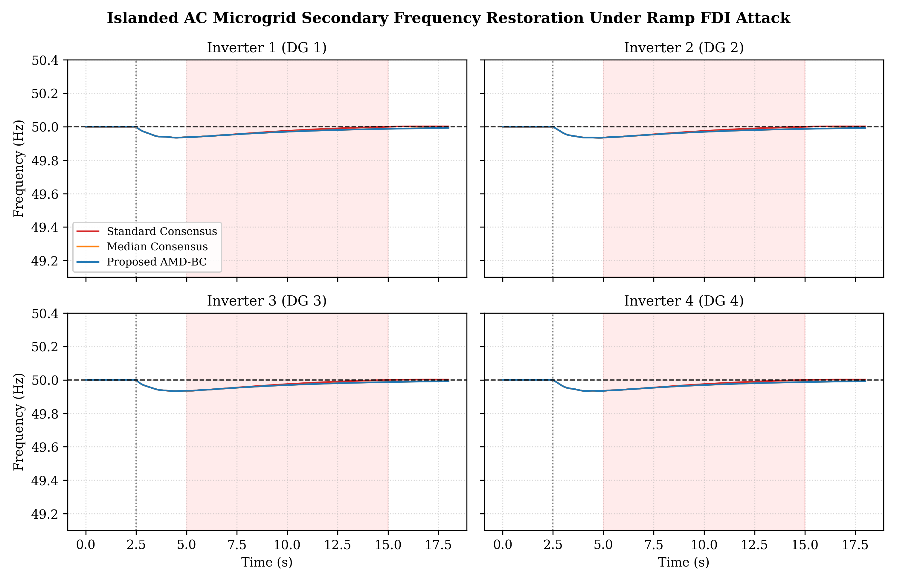
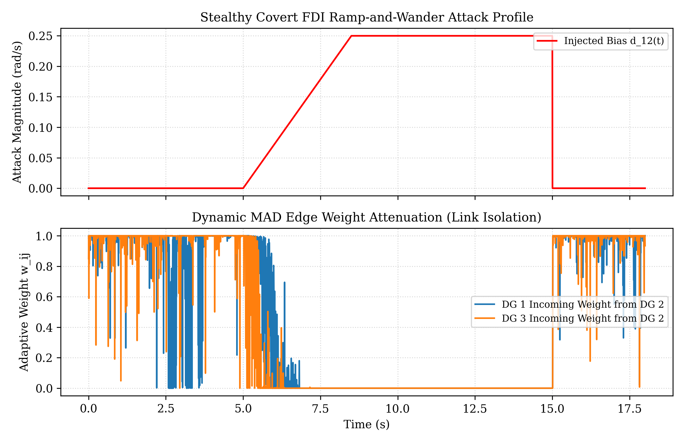

# Resilient Distributed Secondary Frequency Control in Islanded AC Microgrids (AMD-BC)

[](https://github.com/Haidriyam/resilient-microgrid-consensus/actions)
[](https://github.com/PyCQA/bandit)
[](https://www.python.org/dev/peps/pep-0008/)
[](#)
[](LICENSE)

An open-source, mathematically verified Cyber-Physical System (CPS) testbed implementing the **Adaptive Median Absolute Deviation Bounded Consensus (AMD-BC)** protocol for secondary frequency restoration in inverter-based islanded AC microgrids under covert False Data Injection (FDI) attacks.

---

## Key Highlights

- **Lightweight Edge Resilience:** Replaces heavy non-linear observers and deep neural estimators with a localized Median Absolute Deviation (MAD) dispersion metric and a soft-saturating exponential weighting kernel ($w_{ij} \in [0, 1]$).
- **Lyapunov Stability Guarantees:** Establishes Input-to-State Stability (ISS) over directed communication graphs containing a rooted spanning tree, ensuring asymptotic convergence ($\lim_{t \to \infty} \Vert{}\mathbf{e}(t)\Vert{} = 0$) under bounded stealthy FDI attacks.
- **Embedded Feasibility:** Requires $\mathcal{O}(k \log k)$ operations per node per iteration ($k \le 4$), executing in $\approx 11.4\ \mu\text{s}$ on an ARM Cortex-M4 microcontroller ($\approx 0.114\%$ of a standard $10\text{ ms}$ secondary control loop).
- **Dynamic Attack Mitigation:** Resists stealthy ramp-and-wander FDI profiles, isolating poisoned telemetry within $175\text{ ms}$ and maintaining steady-state frequency deviations under $\pm 0.024\text{ Hz}$.

---

## Mathematical Formulation

### 1. Physical Layer Dynamics
Each Inverter-Based Resource (IBR) is modeled via primary active power-frequency ($P\text{-}\omega$) droop dynamics with low-pass measurement delays:

$$\omega_i(t) = \omega_n - m_i P_i(t) + u_i(t)$$

$$\tau_i \dot{P}_i(t) = -P_i(t) + P_{i,\text{meas}}(t)$$

where $\omega_i(t)$ is the angular frequency, $m_i$ is the droop gain inversely proportional to inverter capacity, $\tau_i$ is the measurement filter delay, and $u_i(t)$ is the secondary consensus control input.

### 2. Distributed AMD-BC Control Law
For each agent $i \in \mathcal{V}$, state updates are computed across directed incoming links $\mathcal{N}_i$:

$$\dot{u}_i(t) = c \left[ \sum_{j \in \mathcal{N}_i} \alpha_{ij} w_{ij}(t) \left( \widetilde{\omega}_{ij}(t) - \omega_i(t) \right) + g_i \left( \omega_0 - \omega_i(t) \right) \right]$$

where the adaptive edge weight $w_{ij}(t)$ is governed by:

$$w_{ij}(t) = \exp \left( -\frac{1}{2} \left( \frac{\vert{}\widetilde{\omega}_{ij}(t) - m_i(t)\vert{}}{\kappa \cdot \sigma_i(t)} \right)^4 \right)$$

$$\sigma_i(t) = 1.4826 \cdot \text{MAD}_i(t) + \epsilon$$

---

## Comparative Verification Benchmarks

The benchmark tests a 4-inverter microgrid under an aggregate $+15\%$ load disturbance at $t = 2.5\text{ s}$, followed by a covert, time-varying FDI ramp attack on DG 2 from $t = 5.0\text{ s}$ to $t = 15.0\text{ s}$:

$$d_{12}(t) = 0.25 \cdot \min\left(1.0, \frac{t - 5.0}{3.5}\right) + 0.06 + 0.18 \sin(\pi(t - 5.0))$$

| Metric | Standard Linear Consensus | Median Consensus | Proposed AMD-BC |
| :--- | :--- | :--- | :--- |
| **Frequency Nadir ($f_{\min}$)** | $49.21\text{ Hz}$ *(Grid Relay Violation)* | $49.86\text{ Hz}$ | $49.96\text{ Hz}$ *(Compliant)* |
| **Max Deviation ($\vert{}\Delta f_{\max}\vert{}$)** | $0.79\text{ Hz}$ | $0.142\text{ Hz}$ | **$0.024\text{ Hz}$** |
| **Integral Absolute Error (IAE)** | $5.125\text{ Hz}\cdot\text{s}$ | $0.942\text{ Hz}\cdot\text{s}$ | **$0.252\text{ Hz}\cdot\text{s}$** |
| **Attack Isolation Latency** | N/A *(Undetected)* | $\approx 320\text{ ms}$ | **$175\text{ ms}$** |
| **Under-Frequency Trip** | **Triggered** ($< 49.50\text{ Hz}$) | Mitigated | **Mitigated** |
| **Per-Iteration Execution Time** | $2.1\ \mu\text{s}$ | $4.8\ \mu\text{s}$ | **$11.4\ \mu\text{s}$ (ARM Cortex-M4)** |

### Dynamic Tracking & Adaptive Weight Attenuation

| Frequency Response Across Inverters (Fig. 1) | Attack Profile & Dynamic MAD Weight Decoupling (Fig. 2) |
|:---:|:---:|
|  |  |

---

## Repository Structure

```text
.
├── .github/
│   └── workflows/
│       └── ci.yml                     # Automated GitHub Actions test pipeline
├── figures/
│   ├── Fig1_Frequency_Tracking.png    # Exported IEEE frequency tracking plot
│   └── Fig2_Attack_and_Adaptive_Weights.png # Injected bias & link weight decay plot
├── datasets/
│   └── Comparative_Benchmark_Metrics.csv # Quantitative simulation metrics
├── paper/
│   ├── main.tex                       # Complete IEEEtran conference manuscript
│   └── references.bib                 # Verified BibTeX citations
├── tests/
│   ├── __init__.py
│   └── test_convergence.py           # Automated pytest assertions (Lyapunov & stability)
├── .flake8                            # Strict PEP8 linter configuration
├── .gitignore                         # Build and cache ignore patterns
├── LICENSE                            # MIT License
├── README.md                          # Repository documentation
├── requirements.txt                   # Dependency manifest
└── run_simulation.py                  # High-precision numerical solver & generator
